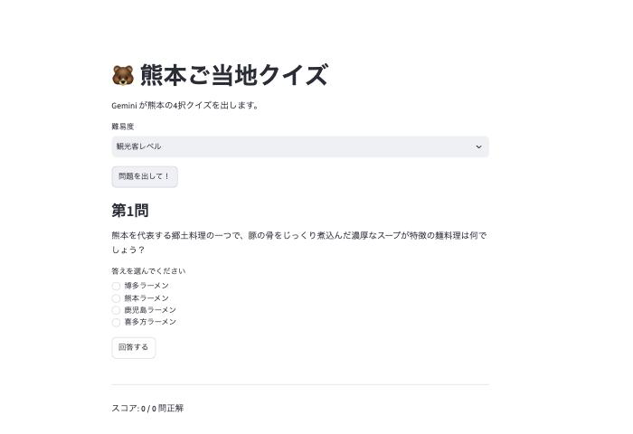
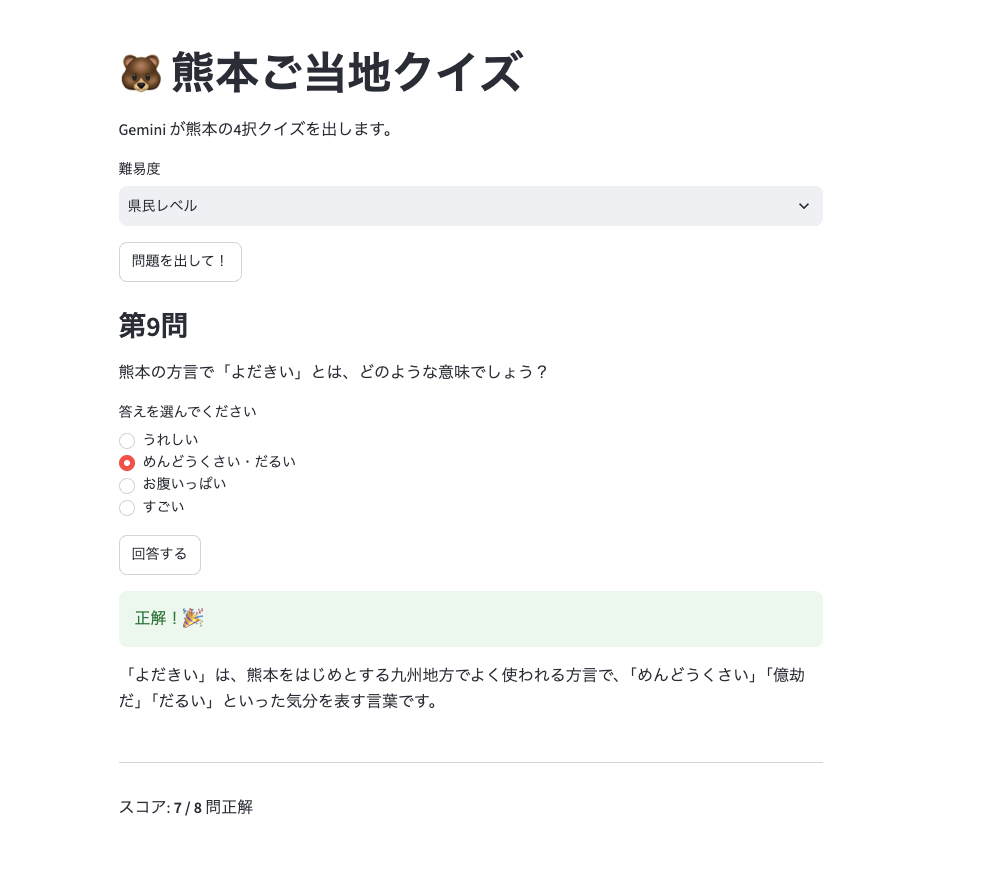

# 🐻 熊本ご当地クイズ

Gemini API を使って、熊本県のご当地クイズを**その場で自動生成**して出題する Web アプリです。
Streamlit で作りました。講座のチャットボットのサンプルをベースに、「チャット」を「クイズ」に作り変えました。



---

## URL

このURLで試すことができます（スリープ状態のときは青色の起動ボタンを押してください）：
https://kumamoto-quiz-fujii.streamlit.app/

---

## 🌟 主な機能

* **クイズの自動生成**: 「問題を出して！」を押すたびに、Gemini が熊本の地理・歴史・グルメ・観光から4択クイズを1問作ります。問題はあらかじめ用意したものではなく、毎回 AI が考えます。
* **難易度の選択**: 「観光客レベル」「県民レベル」「マニアレベル」の3段階から選べます。
* **その場で採点**: ラジオボタンで答えを選んで「回答する」を押すと、正解・不正解と解説が表示されます。
* **スコア表示**: 何問中何問正解したかを数えて画面の下に表示します。

---

## 💡 オリジナリティ（工夫した点）

* **問題データベースを持たない**: 講師の例（TOEIC単語クイズ）は CSV の単語帳から出題しますが、このアプリは問題を一切持たず、Gemini に「熊本のクイズを JSON で1問作って」と頼んで、返ってきた JSON をそのまま出題・採点に使います。問題が無限に出せて、ファイルの用意が不要です。
* **AI の回答を「採点できる形」にした**: 最初は文章でクイズが返ってきて答え合わせができなかったので、プロンプトで「この JSON 形式だけ返して」と指示し、Python 側で `json.loads` して選択肢と正解番号を取り出すようにしました。
* **熊本に特化**: 地元ネタ（熊本城、熊本ラーメン、方言など）に絞って、難易度でネタの深さを変えています。

---

## 🛠 作った流れ（コミット履歴のとおり）

1. 講座のチャットボットのサンプルをそのまま動かす
2. チャット部分をやめて、ボタンを押すとクイズを1問出すだけにする
3. 4択を JSON で返してもらい、ラジオボタンで答えて採点できるようにする
4. JSON の前後に ```json などの余計な文字が付いてエラーになったので、`{` から `}` までだけ取り出すようにする
5. `st.session_state` で正解数を覚えてスコアを出す
6. 難易度（観光客／県民／マニア）を選べるようにする
7. 難易度を f-string で埋め込んだら JSON の `{ }` とぶつかってエラーになったので `{{ }}` に直す
8. Gemini が混んでいると時間切れで落ちるので、待ち時間を 60 秒にしてエラー時はメッセージを出す
9. gemini-3.8-flash だと時間切れになるので、軽い gemini-3.5-flash-lite に変える
10. 方言の問題で「よだきい」（本当は大分・宮崎の言葉）を熊本の方言として出題してきたので、ジャンルから方言を外し、「広く知られた事実だけ」「熊本以外の県のことは使わない」と指示を足す

つまずいたところは、生成AIに聞きながら直しました。

### ⚠️ わかったこと: AI は知らないことも自信満々に答える



方言クイズを出させたら、検索しても出てこない言葉や、隣の県の言葉が「熊本の方言」として出題されました。
AI は事実を調べて答えているのではなく、それっぽい文章を作っているだけなので、答えの検証は人間がする必要があると学びました。

---

## 🛠 セットアップ方法

### 1. 依存ライブラリのインストール

```bash
pip install -r requirements.txt
```

### 2. Gemini API キーの設定

API キーはコードに書かず、Streamlit の Secrets から読み込みます。

* ローカルで動かす場合: `.streamlit/secrets.toml` を作って以下を書く（`.gitignore` 済み）
* Streamlit Community Cloud の場合: アプリの Settings → Secrets に同じ内容を貼る

```toml
GEMINI_API_KEY = "ここにキー"
```

### 3. アプリの起動

```bash
streamlit run streamlit_app.py
```

---

## 💻 使用技術

* **Frontend/UI**: [Streamlit](https://streamlit.io/)
* **AI**: [Gemini API](https://ai.google.dev/)（gemini-3.5-flash-lite、REST を `requests` で直接呼び出し）
* **Hosting**: Streamlit Community Cloud

---

## 💡 今後のロードマップ

* 出題ジャンル（グルメだけ、歴史だけ）を選べるようにする
* 間違えた問題をもう一度出す復習モード
* 他の都道府県にも対応する
